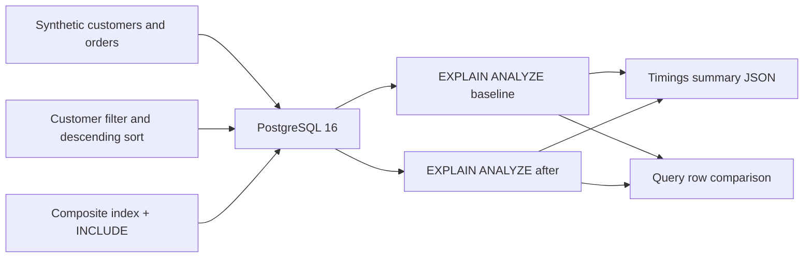

# PostgreSQL Query Tuning: system and evidence

The lab intentionally uses a small, **disposable local database** and a single query. The index strategy was chosen to support equality on `customer_id`, range on `ordered_at`, and the requested ordering. `INCLUDE (total_amount)` may help reduce heap reads for some plans, but index-only access depends on visibility map state and planner cost estimates.

## Test evidence

The CI workflow runs a live PostgreSQL container, captures both raw plans, checks that result rows match, and parses the actual **Execution Time** lines into `results/summary.json`. The JSON reports a signed percent change: negative means faster; positive means slower.

This is **not** proof of a repeatable general speedup. The first query may have cold caches; index creation changes database state; the CI runner has variable hardware. Evaluate `Buffers`, scan choices, and timing together. A stronger benchmark would randomize case order over restored copies, use repeated trials, multiple customer IDs and percentile timings, and inspect index write amplification.

## Production trade-offs

- Indexes add disk usage and write overhead, especially for order-heavy applications.
- Monitoring must include slow query logs, query frequency, p95/p99 response time, locking and saturation.
- Optimize representative queries using isolated replicas or restored snapshots before rollout.
- Apply index changes with migration planning and rollback procedures, not ad hoc production shell scripts.
- Never run `scripts/benchmark.sh` against non-disposable PostgreSQL instances.
